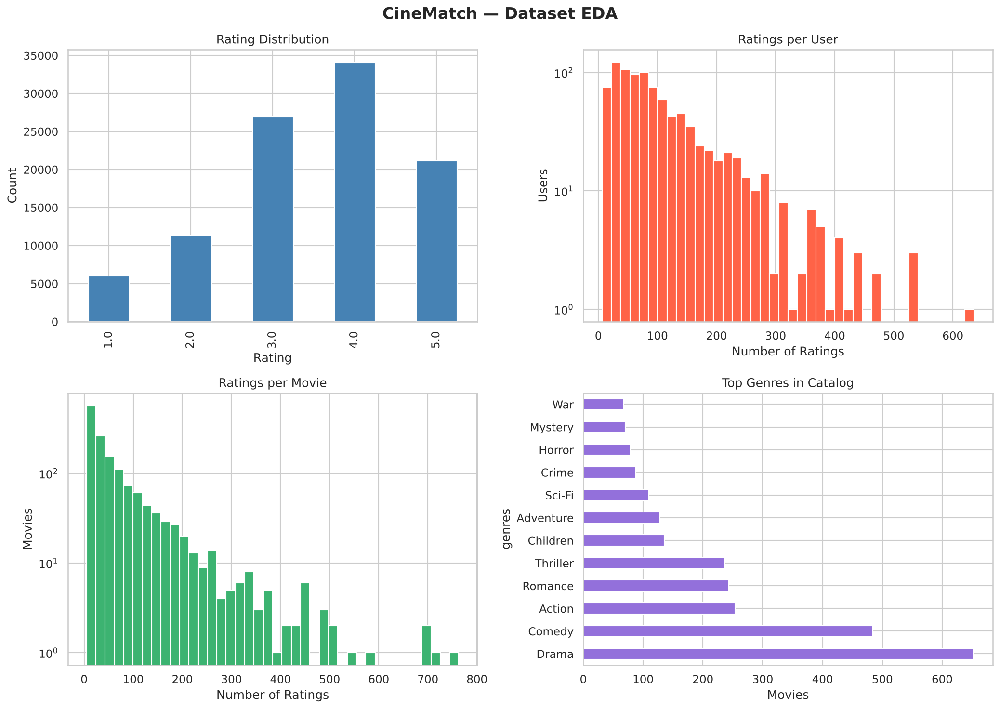
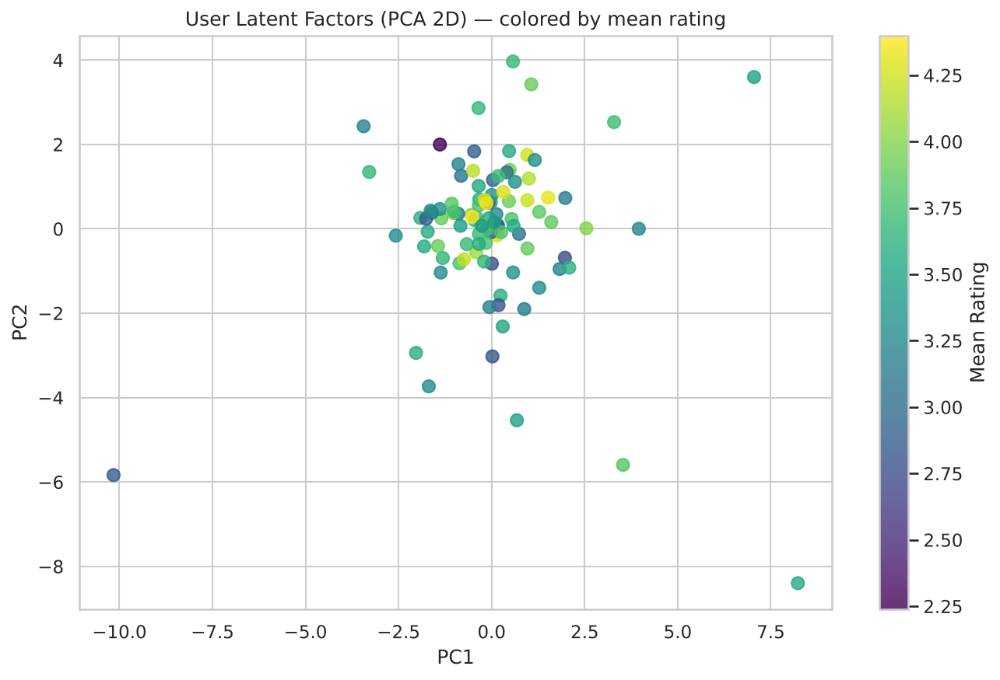
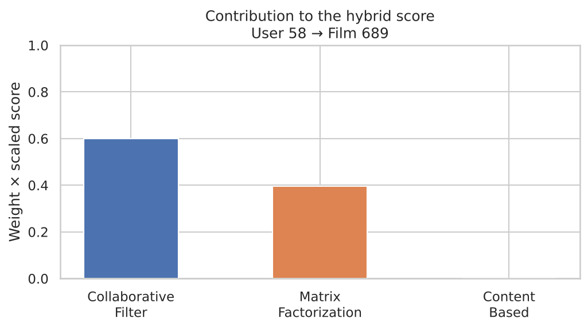

# CineMatch — Hybrid Movie Recommender System

[](https://python.org)
[](#testing)
[](LICENSE)

A production-ready recommender system built from scratch in Python, implementing and comparing three recommendation strategies — Collaborative Filtering, Matrix Factorization, and Content-Based Filtering — fused into a weighted hybrid ensemble.

> **Highlights:** Implements 4 algorithms and 2 baselines, 7 evaluation metrics, a train/validation/test pipeline that tunes on validation data only, 39 unit tests, and a model explainability interface — all without black-box libraries like Surprise or LightFM. The tuned hybrid beats its best single model by 14% on NDCG@10.

---

## Table of Contents

- [Project Overview](#project-overview)
- [Architecture](#architecture)
- [Dataset](#dataset)
- [Models](#models)
- [Results](#results)
- [Quick Start](#quick-start)
- [Project Structure](#project-structure)
- [Evaluation Metrics](#evaluation-metrics)
- [Testing](#testing)
- [Explainability](#explainability)
- [Design Decisions](#design-decisions)

---

## Project Overview

CineMatch recommends movies to users based on their past rating history. It solves the core challenges of recommendation systems:

| Challenge | Approach |
|-----------|----------|
| Data sparsity (93% missing) | Truncated SVD learns dense latent representations |
| Cold-start items | Content-Based Filtering via genre TF-IDF |
| User rating bias | Mean-centering before similarity computation |
| Single-model weakness | Weighted ensemble, with weights chosen on a validation split |
| Evaluation beyond accuracy | Ranking metrics (NDCG, MAP, Precision/Recall @K) |
| Knowing a result is good | Every model is compared with baselines: the global mean, a bias model and popularity |

---

## Architecture

```
┌─────────────────────────────────────────────────────────────┐
│                     HybridRecommender                       │
│                                                             │
│  ┌──────────────┐  ┌──────────────┐  ┌──────────────────┐  │
│  │Collaborative │  │   Matrix     │  │  Content-Based   │  │
│  │  Filtering   │  │Factorization │  │    Filtering      │  │
│  │  (Item-KNN)  │  │    (SVD)     │  │  (TF-IDF genres) │  │
│  │   w = 0.60   │  │   w = 0.40   │  │    w = 0.00      │  │
│  └──────┬───────┘  └──────┬───────┘  └───────┬──────────┘  │
│         │                 │                   │             │
│         └─────────────────┴──────────┬────────┘             │
│                                      ▼                      │
│                          Min-Max Normalize Each             │
│                          Score → Weighted Sum               │
│                                      │                      │
│                                      ▼                      │
│                           Ranked Recommendation List        │
└─────────────────────────────────────────────────────────────┘
```

---

## Dataset

The dataset is a synthetic MovieLens-style corpus generated to match the statistical properties of the real MovieLens 100K benchmark:

| Property | Value |
|----------|-------|
| Users | 943 |
| Movies | 1,682 |
| Ratings | 100,000 (99,529 after dropping users and movies with fewer than 5) |
| Rating scale | 1 – 5 stars, in MovieLens's shares: 6%, 11%, 27%, 34%, 21% |
| Mean rating | 3.53 |
| Matrix density | 7.1% |
| Genres | 18 categories, 1–3 per movie, weighted by real genre frequency |

**Why synthetic data?**  
MovieLens's license allows research use but not redistribution, so this repo generates equivalent data instead, with no downloads. The ratings have structure planted the way real rating data behaves:

- **Biases:** some users rate generously, and some movies are better liked
- **Hidden tastes:** every user and movie has an 8-dimensional latent vector, and ratings rise with their dot product
- **Genres that matter:** part of each movie's latent vector comes from its genres
- **Self-selection:** who rates what depends on user activity, movie popularity and how much the user is likely to enjoy the movie

Because the structure is known, the results can be checked: a model that learns anything must beat the baselines below.

```bash
python generate_data.py          # regenerate data/
python generate_data.py --seed 7 # different random seed
```

---

## Models

### 1. Item-Based Collaborative Filtering (`src/collaborative_filter.py`)

Computes cosine similarity between item vectors in user-rating space, and serves two jobs:

- **Rating prediction:** for each candidate item, finds the K most similar items the target user has rated and takes a similarity-weighted average of the user's ratings, measured from their own mean.
- **Top-N ranking:** scores each item by the sum of its similarities to everything the user has rated (Deshpande & Karypis, 2004), and recommends the highest scores.

**Key design choices:**
- Mean-centers user ratings before similarity computation for rating prediction (reduces high/low rater bias); ranking uses plain cosine (see [Design Decisions](#design-decisions))
- Supports both user-based and item-based modes
- Handles unrated items gracefully via fallback to user mean

### 2. Matrix Factorization via Truncated SVD (`src/matrix_factorization.py`)

Decomposes the mean-centered user-item matrix into user and item latent factor matrices using `scipy.sparse.linalg.svds`. The dot product of user and item vectors gives the predicted rating.

```
R ≈ U · Σ · Vᵀ   →   ŷ(u, i) = uᵤ · vᵢ + μᵤ
```

- **10 latent factors**, chosen on a validation split (more factors overfit: validation NDCG@10 falls from 0.134 at 10 factors to 0.075 at 50); fix it with `--n_factors`
- Vectorized batch prediction with `np.einsum`
- Supports model persistence via `pickle`

### 3. Content-Based Filtering (`src/content_based.py`)

Builds a TF-IDF item profile matrix from pipe-separated genre tags. A user profile is constructed as the weighted average of profiles of items the user has rated (weights = rating − threshold). Cosine similarity ranks unseen items.

**Advantage:** Works for new items with no rating history (item cold-start).

### 4. Hybrid Ensemble (`src/hybrid_recommender.py`)

Each model's scores are independently min-max normalized to [0, 1], then combined via weighted sum:

```python
score = 0.60 * cf_score + 0.40 * mf_score + 0.00 * cb_score
```

`train.py` chooses the weights on a validation split held out of the training data, trying every combination in steps of 0.1 (66 in all, including each model alone). Content-based filtering gets zero weight because every movie in the evaluation already has ratings, so collaborative signals beat genre similarity. Its value is for brand-new movies, which this evaluation doesn't include.

---

## Results

Evaluated on a held-out 20% test split, with the number of SVD factors and the hybrid weights chosen on a separate validation split. Reproduce with `python generate_data.py && python train.py`.

### Rating Prediction (5,000 test ratings, lower is better)

| Model | RMSE | MAE |
|-------|------|-----|
| Global mean | 1.126 | 0.948 |
| Bias baseline (μ + b_u + b_i) | 1.001 | 0.800 |
| Matrix factorization (10 factors) | 0.960 | 0.766 |
| Item-based CF (K = 20) | **0.907** | **0.709** |

### Ranking Quality (K=10, all 926 test users with a 4+ rating, higher is better)

| Model | Precision@10 | Recall@10 | NDCG@10 | MAP@10 |
|-------|--------------|-----------|---------|--------|
| Popularity | 0.156 | 0.155 | 0.209 | 0.108 |
| Content-based | 0.017 | 0.014 | 0.020 | 0.007 |
| Item-based CF | 0.164 | 0.150 | 0.223 | 0.120 |
| Matrix factorization | 0.184 | 0.160 | 0.248 | 0.144 |
| **Hybrid (0.6 CF + 0.4 MF)** | **0.213** | **0.183** | **0.283** | **0.169** |

The hybrid beats its best single model (matrix factorization) by 14% on NDCG@10, and popularity by 35%. A test rating of 4 or 5 counts as a relevant recommendation.

### Visualizations

| EDA | Latent Space |
|-----|-------------|
|  |  |

---

## Quick Start

### 1. Clone and install

```bash
git clone https://github.com/anadikulkarni/hybrid-movie-recommender-system.git
cd hybrid-movie-recommender-system
pip install -r requirements.txt
```

### 2. Generate data

```bash
python generate_data.py
```

### 3. Train all models

```bash
python train.py                          # tune on validation, then evaluate on test (~40 s)
python train.py --n_factors 50           # fix the SVD factors instead of tuning them
python train.py --weights 0.3 0.5 0.2    # fix the hybrid weights (CF, MF, CB)
```

Results go to `outputs/evaluation_results.json`.

### 4. Get recommendations for a specific user

```python
from src.data_loader import DataLoader
from src.hybrid_recommender import HybridRecommender
from scipy.sparse import csr_matrix

loader = DataLoader().load().preprocess()
uim = loader.build_user_item_matrix()

hybrid = HybridRecommender()
hybrid.fit(uim, loader.movies, loader.ratings,
           loader.user_id_map, loader.item_id_map)

recs = hybrid.recommend(user_id=42, n=10)
print(recs)
```

### 5. Run the notebook

```bash
jupyter notebook notebooks/01_eda_and_modeling.ipynb
```

---

## Project Structure

```
hybrid-movie-recommender-system/
├── src/
│   ├── data_loader.py          # Data I/O, preprocessing, matrix construction
│   ├── baselines.py            # Bias model and popularity baselines
│   ├── collaborative_filter.py # User/Item KNN collaborative filtering
│   ├── matrix_factorization.py # Truncated SVD with latent factors
│   ├── content_based.py        # TF-IDF genre profiles + user taste vectors
│   ├── hybrid_recommender.py   # Weighted ensemble of all three models
│   └── evaluator.py            # RMSE, MAE, Precision/Recall/NDCG/MAP @K
├── tests/
│   └── test_recommender.py     # 39 unit + integration tests (pytest)
├── notebooks/
│   └── 01_eda_and_modeling.ipynb
├── docs/
│   ├── eda_plots.png
│   ├── matrix_heatmap.png
│   ├── latent_factors.png
│   └── explainability.png
├── data/                       # Generated by generate_data.py (gitignored)
├── outputs/                    # Evaluation results, sample recs (gitignored)
├── generate_data.py            # Reproducible synthetic dataset generator
├── train.py                    # CLI tuning, training and evaluation pipeline
├── requirements.txt
├── setup.py
└── README.md
```

---

## Evaluation Metrics

| Metric | Type | What it measures |
|--------|------|-----------------|
| RMSE | Rating prediction | Penalizes large errors more than MAE |
| MAE | Rating prediction | Average absolute error in predicted rating |
| Precision@K | Ranking | Fraction of top-K recs that are relevant |
| Recall@K | Ranking | Fraction of all relevant items retrieved in top-K |
| F1@K | Ranking | Harmonic mean of Precision and Recall |
| NDCG@K | Ranking | Position-aware: rewards relevant items ranked higher |
| MAP@K | Ranking | Mean Average Precision across users |

---

## Testing

```bash
pytest tests/ -v
```

```
39 passed in 1.6s
```

Tests cover:
- Metric correctness (RMSE, MAE, NDCG edge cases)
- CF similarity matrix properties (diagonal = 1, shape, seen-item exclusion), rating scale and neighbourhood scores
- MF output shapes, prediction range, score ordering
- Content-based profile construction and self-exclusion
- Hybrid fit → recommend → explain pipeline, weight normalisation and score scaling
- Baselines: damped biases, clipping, popularity order
- Evaluator coverage, repeatable user sampling and JSON-safe output
- Synthetic data: unique pairs, MovieLens star shares, and signal a baseline can learn

---

## Explainability

The hybrid model supports per-prediction score breakdown. Each score is the sub-model's raw score: the CF neighbourhood score (summed similarities), the MF predicted rating and the CB genre similarity.

```python
explanation = hybrid.explain(user_id=42, movie_id=392)
# {
#   'userId': 42, 'movieId': 392,
#   'cf_score': 11.246,
#   'mf_score': 3.584,
#   'cb_score': 0.447,
#   'weights': {'cf': 0.6, 'mf': 0.4, 'cb': 0.0}
# }
```

The notebook turns this into each model's contribution to the final score (weight × score scaled to 0–1):



---

## Design Decisions

**Why not use Surprise or LightFM?**  
Building from scratch demonstrates understanding of the underlying math rather than API usage. Every formula — cosine similarity, SVD decomposition, TF-IDF weighting — is explicitly implemented and testable.

**Why mean-center before similarity?**  
Users have different rating scales (some always rate 4–5, others 1–3). Subtracting each user's mean rating isolates preference signal from scale bias, leading to more meaningful similarity scores for rating prediction.

**Why a different similarity for ranking?**  
Rating prediction and top-N ranking reward different things. Mean-centred (adjusted) cosine measures whether people agree on how good two movies are: it gives the best RMSE here (0.907, against 0.994 with plain cosine). Ranking rewards finding the movies a user will actually rate highly, and people mostly rate what they choose to watch, so plain cosine, which mostly measures whether the same people watch both movies, ranks far better (NDCG@10 0.223, against 0.104). Ranking by predicted rating is worse still (0.074), because it pushes obscure movies with a couple of glowing neighbours to the top.

**Why weighted hybrid?**  
Each model has complementary failure modes: CF fails on cold-start items, MF struggles with very sparse users, CB ignores collaborative patterns. Combining them improves robustness without complex meta-learning. The weights and the number of SVD factors are chosen on a validation split, never on the test set, so the reported results aren't tuned to it.

**Why baselines?**  
A metric means little on its own: with random ratings every model still reports an RMSE, and only a baseline shows it learned nothing. So every rating model has to beat the bias model, and every ranker has to beat popularity.

**Why synthetic data?**  
Full reproducibility. Running `python generate_data.py` gives any reviewer an identical dataset in about a second with no authentication, downloads, or license agreements, and its planted structure makes the results checkable.

---

## License

MIT License — see [LICENSE](LICENSE) for details.
